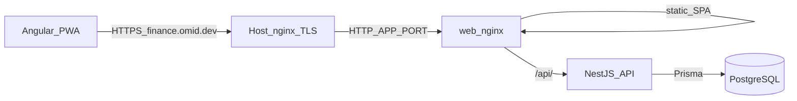

# System Design

Living architecture overview for this project. Product purpose and scope live in [vision.md](vision.md) and [plans/mvp.md](plans/mvp.md). Rationale for expensive choices lives in [decisions/](decisions/).

**Status:** MVP ledger path in place: auth, wallets/accounts, transactions/transfers, statement import (`generic_csv` + `blubank_xlsx`) + dedupe, recurrings + next-month forecast; UI IA filled for Activity / Import / Outlook / home. Instance admin, i18n, Docker deploy as before. Further bank adapters and post-MVP ideas remain backlog.

When architecture or stack choices change, update this file in the same change set as the related `DEC-NNN` record.

## Shape

- **Runtime:** Node.js 24 (LTS) for local API/tooling and Compose build images ([DEC-002](decisions/DEC-002-stack.md)).
- **System of record:** NestJS 12 REST API over PostgreSQL (Prisma 7 + `pg` adapter).
- **First client:** Angular PWA with PrimeNG; installable shell; money data online-only.
- **Contracts:** Zod 4 schemas in a shared package for HTTP DTOs; do not expose Prisma models to the web app.
- **Money:** integer minor units of each account’s ISO currency; IRR toman only as explicit UI presentation; no FX and no cross-currency net worth ([DEC-006](decisions/DEC-006-money-multi-currency.md)).
- **Identity:** httpOnly cookie sessions; optional TOTP 2FA; profile ([DEC-007](decisions/DEC-007-auth.md)); instance `ADMIN` / `USER` with registration toggle ([DEC-010](decisions/DEC-010-instance-admin.md)).
- **Household:** personal wallets + optional shared accounts ([DEC-005](decisions/DEC-005-wallets-and-accounts.md)).
- **Deploy:** Docker Compose (`postgres` + `api` + `web`); `api`/`web` images from GHCR (CI on `master`); same-origin `/api` proxy; TLS at host nginx ([DEC-008](decisions/DEC-008-self-hosted-docker.md), [DEC-018](decisions/DEC-018-ci-container-images.md)).
- **UI language:** runtime Transloco catalogs (`fa`, `en`); localStorage cache + profile `locale`; profile hydrates (and overrides cache) on login/session; RTL via `html[dir]` ([DEC-009](decisions/DEC-009-i18n.md)).
- **Calendar:** profile `calendar` (`GREGORIAN` | `JALALI`, default Jalali) + timezone; ISO storage; display, pickers, month filters, and next-month forecast follow the preference ([DEC-013](decisions/DEC-013-calendar-preference.md)).
- **Theme:** profile `theme` (`LIGHT` | `DARK` | `SYSTEM`, default System); localStorage cache + hydrate on login/session; resolved dark via `html.app-dark` for PrimeNG Aura and app CSS tokens; Settings icon segmented control only ([DEC-015](decisions/DEC-015-theme-preference.md)).
- **UI information architecture:** hybrid home; App vs Admin shells; user menu (Settings / Support / Sign out); language switcher on Guest shell and Settings only; dedicated routes for activity, accounts, outlook, settings, support; import as a dialog from Activity / Account detail ([plans/ui-ux.md](plans/ui-ux.md), [DEC-011](decisions/DEC-011-ui-ia.md)).

Decisions: [DEC-001](decisions/DEC-001-client-server-split.md), [DEC-002](decisions/DEC-002-stack.md), [DEC-003](decisions/DEC-003-pwa-scope.md), [DEC-004](decisions/DEC-004-money-storage-display.md) (superseded), [DEC-005](decisions/DEC-005-wallets-and-accounts.md), [DEC-006](decisions/DEC-006-money-multi-currency.md), [DEC-007](decisions/DEC-007-auth.md), [DEC-008](decisions/DEC-008-self-hosted-docker.md), [DEC-009](decisions/DEC-009-i18n.md), [DEC-010](decisions/DEC-010-instance-admin.md), [DEC-011](decisions/DEC-011-ui-ia.md), [DEC-012](decisions/DEC-012-import-adapters.md), [DEC-013](decisions/DEC-013-calendar-preference.md), [DEC-014](decisions/DEC-014-mit-license.md), [DEC-015](decisions/DEC-015-theme-preference.md), [DEC-018](decisions/DEC-018-ci-container-images.md).

## Repository layout

```text
/
  apps/
    api/          # NestJS + Prisma
    web/          # Angular + PrimeNG PWA
  packages/
    shared/       # Zod schemas + shared TypeScript types
  docs/
  tasks/
```

- Package manager: **pnpm** workspaces.
- Postgres and production stack: **Docker Compose** ([DEC-008](decisions/DEC-008-self-hosted-docker.md)).

## Runtime



- REST under `/api/v1/...` (JSON; multipart for statement uploads).
- Production web serves the SPA and proxies `/api/` to the API (same-origin cookies).
- Host nginx terminates TLS for `finance.omid.dev` and forwards to Compose `APP_PORT` ([DEC-008](decisions/DEC-008-self-hosted-docker.md)).
- Domain rules (balances, transfers, import deduplication, forecast vs actuals) live in the API and are tested without the UI.
- Authorize mutating API routes ([DEC-007](decisions/DEC-007-auth.md)).

## API module map (MVP)

Aligned with [plans/mvp.md](plans/mvp.md):

| Area | Responsibility |
| --- | --- |
| `auth` | Register, login, logout, session cookies, optional TOTP enroll/verify; registration status |
| `users` / profile | Display name, locale, timezone, calendar preference ([DEC-013](decisions/DEC-013-calendar-preference.md)), theme preference ([DEC-015](decisions/DEC-015-theme-preference.md)) |
| `admin` | Instance settings (registration open), user list/role/disable/delete; admin access to any user’s wallets/accounts ([DEC-010](decisions/DEC-010-instance-admin.md)) |
| `wallets` | Personal wallets; ownership |
| `accounts` | Accounts (personal or shared), per-account currency; balance checkpoints ([plans/balance-checkpoints.md](plans/balance-checkpoints.md), [DEC-017](decisions/DEC-017-balance-checkpoints.md)) |
| `transactions` | Manual income/expense; same-currency transfers; optional shared mark on personal expenses ([plans/transactions.md](plans/transactions.md)) |
| `categories` | Per-user income/expense/transfer category lists (system catalog via codes + i18n, icons, palette colors; user CRUD; required on all movements) ([plans/transactions.md](plans/transactions.md), [DEC-016](decisions/DEC-016-category-catalog.md)) |
| `imports` | Pluggable adapters (`generic_csv`, `blubank_xlsx`, …); deduplicated re-import ([plans/imports.md](plans/imports.md), [DEC-012](decisions/DEC-012-import-adapters.md)) |
| `recurrings` | Recurring income/expense/transfer rules (daily–yearly schedules) for forecast only ([plans/recurrings-forecast.md](plans/recurrings-forecast.md)); managed under `/outlook`; optional create-from Add dialog |
| `forecast` | Next-month outlook from expected income and expense recurrings (transfers excluded from surplus); labeled projections; per currency ([plans/recurrings-forecast.md](plans/recurrings-forecast.md)) |

## Frontend rules

- Thin client over the API (`apiBaseUrl`); no direct database access; credentials via httpOnly cookies (`withCredentials`).
- PrimeNG is the sole UI component kit (Aura; class-based light/dark via profile theme ([DEC-015](decisions/DEC-015-theme-preference.md))).
- PWA service worker: precache shell/assets; **network-only** for `/api/*` (no offline money cache in MVP).
- UI strings via Transloco JSON (`public/i18n/`); Farsi sets `dir=rtl` and a Persian-capable font; English is LTR ([DEC-009](decisions/DEC-009-i18n.md)).
- Gregorian and Persian (Jalali) dates via profile calendar preference; separate from UI language catalogs ([DEC-013](decisions/DEC-013-calendar-preference.md)).
- Prefer Angular over React unless a future need forces a revisit ([DEC-002](decisions/DEC-002-stack.md)).
- **Screens, nav, and interaction patterns** follow [plans/ui-ux.md](plans/ui-ux.md) ([DEC-011](decisions/DEC-011-ui-ia.md)): hybrid home; App vs Admin shells with user menu; list-first pages (create/edit in dialog, drawer, or sub-route); no always-on CRUD form stacks; Status out of primary nav.

## Related docs

| Doc | Role |
| --- | --- |
| [vision.md](vision.md) | Why and principles |
| [plans/mvp.md](plans/mvp.md) | First release scope |
| [plans/transactions.md](plans/transactions.md) | Manual transactions, transfers, categories ([DEC-016](decisions/DEC-016-category-catalog.md)) |
| [plans/balance-checkpoints.md](plans/balance-checkpoints.md) | Dated known balances; gaps; replaces opening balance ([DEC-017](decisions/DEC-017-balance-checkpoints.md)) |
| [plans/imports.md](plans/imports.md) | Statement import adapters and deduplication |
| [plans/recurrings-forecast.md](plans/recurrings-forecast.md) | Recurring rules and next-month forecast |
| [plans/ui-ux.md](plans/ui-ux.md) | UI sitemap, shells, screen patterns |
| [decisions/](decisions/) | Decision records |
| [../AGENTS.md](../AGENTS.md) | Contributor / agent rules |
