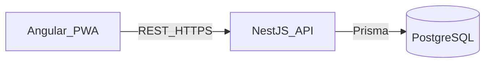

# System Design

Living architecture overview for this project. Product purpose and scope live in [vision.md](vision.md) and [plans/mvp.md](plans/mvp.md). Rationale for expensive choices lives in [decisions/](decisions/).

**Status:** architecture decided in docs; application code and local tooling (package manager, Docker) not scaffolded yet.

When architecture or stack choices change, update this file in the same change set as the related `DEC-NNN` record.

## Shape

- **System of record:** NestJS REST API over PostgreSQL (Prisma).
- **First client:** Angular PWA with PrimeNG; installable shell; money data online-only.
- **Contracts:** Zod schemas in a shared package for HTTP DTOs; do not expose Prisma models to the web app.
- **Money:** integer IRR (rials) in storage and API; toman only as explicit UI presentation.

Decisions: [DEC-001](decisions/DEC-001-client-server-split.md), [DEC-002](decisions/DEC-002-stack.md), [DEC-003](decisions/DEC-003-pwa-scope.md), [DEC-004](decisions/DEC-004-money-storage-display.md).

## Intended repository layout

Not created on disk yet:

```text
/
  apps/
    api/          # NestJS + Prisma
    web/          # Angular + PrimeNG PWA
  packages/
    shared/       # Zod schemas + shared TypeScript types
  docs/
  tasks/
```

## Runtime



- REST under `/api/v1/...` (JSON; multipart for statement uploads).
- Domain rules (balances, transfers, import deduplication, forecast vs actuals) live in the API and are tested without the UI.
- Initial deploy target: self-hosted, single household; authorize mutating API routes when auth is implemented.
- Package manager and Docker (or other) Postgres for local dev are **deferred**.

## API module map (MVP)

Aligned with [plans/mvp.md](plans/mvp.md):

| Area | Responsibility |
| --- | --- |
| `accounts` | Accounts and opening balances |
| `transactions` | Manual income/expense; transfers that do not inflate income/expense totals |
| `categories` | Categories or tags as needed for daily use |
| `imports` | One bank CSV/Excel adapter first; pluggable path for more; deduplicated re-import |
| `recurrings` | Recurring rules used for forecast only |
| `forecast` | Next-month outlook from expected income and recurrings; labeled projections |

## Frontend rules

- Thin client over the API (`apiBaseUrl`); no direct database access.
- PrimeNG is the sole UI component kit (one theme when scaffolded).
- PWA service worker: precache shell/assets; **network-only** for `/api/*` (no offline money cache in MVP).
- RTL-ready hooks for Persian later; Gregorian and Persian dates as product requires.
- Prefer Angular over React unless a future need forces a revisit ([DEC-002](decisions/DEC-002-stack.md)).

## Open product questions (not design defaults)

Do not invent answers here; resolve via MVP or new DECs:

- Single household ledger vs separate wallets for partners
- Day-to-day recording of transfers and shared expenses
- Exact banks and file formats for the first import adapter

## Related docs

| Doc | Role |
| --- | --- |
| [vision.md](vision.md) | Why and principles |
| [plans/mvp.md](plans/mvp.md) | First release scope |
| [decisions/](decisions/) | Decision records |
| [../AGENTS.md](../AGENTS.md) | Contributor / agent rules |
