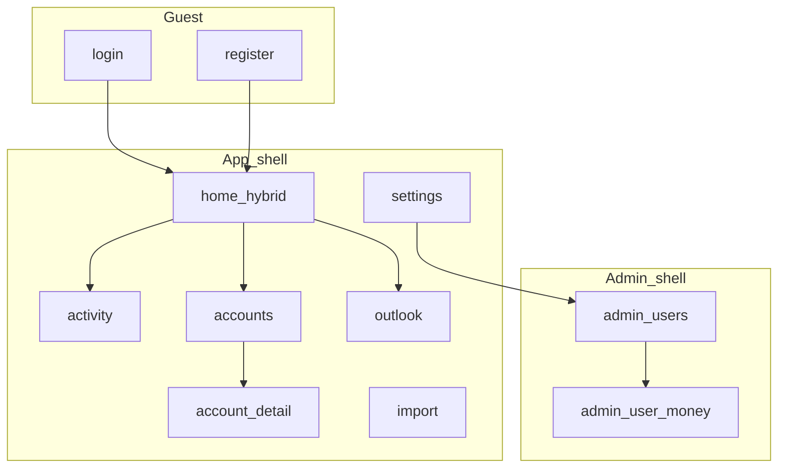

# UI / UX plan

Product UI information architecture and interaction patterns for the Angular PWA. Stack and client rules live in [design.md](../design.md). Scope and acceptance for the first release live in [mvp.md](mvp.md). Expensive IA choices: [DEC-011](../decisions/DEC-011-ui-ia.md).

**Status:** accepted as the source of truth for app structure. Implement shell and screens against this plan; do not invent parallel navigation or always-on CRUD stacks.

## Goals

1. Feel like a **personal finance app**, not a broken admin console of stacked forms.
2. Give every MVP workflow a **dedicated place** in the sitemap (home, activity, accounts, import, outlook, settings, admin).
3. Make the daily landing a **hybrid home**: balances, quick-add, and a short next-month outlook.
4. Keep **actuals distinct from projections** in layout and labeling.
5. Keep **instance admin** visually and structurally separate from personal money workflows.

## Non-goals

- Marketing / promotional landing page
- Full design-system component library beyond shared app patterns on PrimeNG
- Recipe / costing UI, settlement / IOU UX, rich household invite (see MVP out of scope and backlog)
- Rebrand or dark theme; keep the current visual direction and document tokens
- Jalali date-picker productization in this plan (placeholder only; calendars come later)

## Principles

1. **IA before chrome polish** — routes, shells, and “where does this live?” come first; visual polish follows.
2. **Lists first** — list/detail pages show data and a clear primary action; create/edit open in a dialog, drawer, or dedicated route — never always-visible form stacks under every list.
3. **Money is transparent** — balances and costs must show how they are derived (opening + movements when available); never silent rial/toman inference ([DEC-006](../decisions/DEC-006-money-multi-currency.md)).
4. **Actuals ≠ forecast** — Activity and account ledgers are historical; Outlook (and the home strip) are labeled projections ([mvp.md](mvp.md)).
5. **No cross-currency net worth** — group and total only within a currency ([DEC-006](../decisions/DEC-006-money-multi-currency.md)).
6. **One primary job per screen** — home composes three tight sections; other routes stay focused.
7. **RTL and i18n are first-class** — `fa` / `en`, logical CSS, PrimeNG locale tied to language ([DEC-009](../decisions/DEC-009-i18n.md)).

## Shells

Two shells ([DEC-011](../decisions/DEC-011-ui-ia.md)):

| Shell | Who | Chrome |
| --- | --- | --- |
| **App** | Authenticated user | Brand, primary nav, overflow (Settings; Admin link if role), language control |
| **Admin** | Instance `ADMIN` | Distinct admin header/context; back to app; not the personal Accounts mental model |
| **Guest** | Unauthenticated | Minimal chrome (brand + language); centered auth forms; no primary money nav |

**Status / API health** is not a primary-nav peer. Expose under Settings (or a hidden/dev route) only.

**Post-login / post-register** navigates to **`/`** (hybrid home), not profile.

## Sitemap (MVP)

### Guest

| Route | Purpose |
| --- | --- |
| `/login` | Sign in; optional TOTP second step |
| `/register` | Register when open / bootstrap; gated by registration status |

### App

| Route | Purpose |
| --- | --- |
| `/` | Hybrid home (balances + quick-add + outlook strip) |
| `/activity` | Ledger list + time-range filters; full add/edit entry |
| `/accounts` | Wallets → accounts hierarchy and balances |
| `/accounts/:accountId` | Account detail, movements, shared members |
| `/import` | Statement upload, adapter choice, dedup feedback |
| `/outlook` | Next-month forecast detail (home shows summary only) |
| `/settings` | Profile, locale/timezone, TOTP, sign-out; link to Status/health if kept |

Legacy `/wallets` and `/profile` should redirect into Accounts and Settings when the shell lands.

### Admin

| Route | Purpose |
| --- | --- |
| `/admin` | Registration toggle; user list (role, disable, delete) |
| `/admin/users/:userId` | Context banner “Acting as …”; that user’s wallets/accounts |

### Primary navigation (App)

**Home · Activity · Accounts · Import · Outlook**

Settings (and **Admin** when `ADMIN`) live in an overflow / account menu — not as equal top-level CRUD links beside Status.

On narrow viewports, primary nav may collapse to a bottom bar or drawer; labels and order stay the same.

## Hybrid home (`/`)

One composition with three sections. Missing data uses empty states, not blank panels.

1. **Balances** — accounts grouped by currency (and wallet as secondary grouping). Show per-account balance; optional per-currency subtotal. **No** single cross-currency total. IRR toman presentation uses the shared money display + labeled toggle ([DEC-006](../decisions/DEC-006-money-multi-currency.md)). CTA: open Accounts or an account detail.
2. **Quick add** — income or expense for a chosen account (category when categories exist). Transfers and “shared” mark belong on Activity or account detail, not the home strip.
3. **Outlook strip** — short next-month summary **per currency**, clearly labeled as projections; link to `/outlook`. Until forecast API exists, show a stub empty state (“Outlook comes after recurrings”) without inventing numbers.

When the user has no accounts: balances empty state with primary CTA “Create account”; quick-add and outlook disabled or explanatory.

## Screen inventory

### Login / Register

- Purpose: authenticate; respect registration open/bootstrap ([DEC-007](../decisions/DEC-007-auth.md), [DEC-010](../decisions/DEC-010-instance-admin.md)).
- Primary actions: submit; link between login and register; language switcher.
- Errors: inline message; no stack of unrelated panels.

### Home

- See [Hybrid home](#hybrid-home-).
- Loading: skeletons for balance rows; do not flash raw empty forms.

### Activity (`/activity`)

- Purpose: chronological ledger of actual movements; filter by useful time range.
- Primary actions: add income/expense; add transfer; open row to edit/detail when supported.
- Empty: “No movements yet” + CTA to add or import.
- Must not mix unlabeled forecast rows into this list.

### Accounts (`/accounts`)

- Purpose: structure — wallets and accounts with balances.
- Primary actions: create wallet / create account via dialog or dedicated sub-route; navigate to account detail.
- Empty: CTA to create first wallet/account.
- **Not** a page of always-visible create forms under the list.

### Account detail (`/accounts/:accountId`)

- Purpose: one account’s balance story, movements, shared badge, member management (email add/remove per [wallets-accounts.md](wallets-accounts.md)).
- Primary actions: add movement/transfer; manage members if shared; edit name when API allows.

### Import (`/import`)

- Purpose: upload statement; choose adapter (generic/synthetic first); confirm units when ambiguous (never silent rial/toman).
- After upload: show created count and skipped-duplicate count ([mvp.md](mvp.md) acceptance).
- Empty / first visit: short explanation + file picker.

### Outlook (`/outlook`)

- Purpose: next-month expected income, recurrings, surplus/shortfall **per currency**, labeled projections.
- Empty until recurrings exist: explain and link to where recurrings will be managed (settings or outlook sub-area when specified).

### Settings (`/settings`)

- Purpose: display name, locale, timezone, language alignment with [DEC-009](../decisions/DEC-009-i18n.md); TOTP enroll/disable; sign-out; optional Status/health link; Admin entry for admins.

### Admin (`/admin`, `/admin/users/:userId`)

- Purpose: instance control ([DEC-010](../decisions/DEC-010-instance-admin.md)) — registration, users, then “acting as” money management.
- **Acting-as banner** required on user money views so they are never confused with the admin’s own Accounts.
- Destructive actions: ConfirmDialog (not `window.confirm`); last-admin safeguards surfaced in UI copy.
- Money presentation matches App (shared money component), including IRR toman labeling.

## Shared patterns

### Money display

- Input/storage: integer minor units as digit strings on the wire.
- Display: shared formatter; currency code visible; IRR may offer **labeled** toman toggle (`÷ 10`); toggle preference may be local (document persistence when implemented).
- Same component on home, accounts, activity amounts, admin-as-user views.
- Never show a merged multi-currency “net worth”.

### Dates

- Product will need Gregorian and Persian calendars; **Jalali pickers are out of this plan’s implementation scope**. Until then, use unambiguous ISO/Gregorian display with timezone from profile; do not pretend locale alone equals calendar system ([DEC-009](../decisions/DEC-009-i18n.md)).

### Forms and chrome

- Prefer PrimeNG Select over native `<select>` for visual consistency.
- Create/edit: Dialog or Drawer; ConfirmDialog for delete/disable; Toast for success feedback.
- Loading: ProgressSpinner / skeleton — not bare “Loading…” as the only pattern.
- Empty states: one sentence + one primary CTA.
- Online-only ledger: if API unreachable, show a clear reconnect message ([DEC-003](../decisions/DEC-003-pwa-scope.md)).

### Visual tokens (keep current direction)

Document in implementation, do not rebrand:

- Fonts: IBM Plex Sans (body), Source Serif 4 (headings/brand), Vazirmatn when `lang=fa`
- Accent / links: teal around `#0f6b61`; page ground sage/gray `#eef3f1`; text `#1c2a27`
- Theme: PrimeNG Aura; no dark mode in MVP
- Prefer CSS variables in `styles.scss` for shared shell/page spacing so page SCSS stops forking hex values

### i18n

- All new chrome strings in `public/i18n/fa.json` and `en.json`.
- API error bodies may stay untranslated; client shows catalog fallbacks where useful.

## Mapping unbuilt MVP features into slots

| MVP capability | UI slot |
| --- | --- |
| Manual income/expense | Home quick-add; Activity; Account detail |
| Same-currency transfers | Activity; Account detail (not home quick-add) |
| Shared mark on personal expense | Activity / detail forms |
| Categories/tags | Fields on add/edit when API exists |
| CSV import + dedup | `/import` |
| Recurring rules | Managed in or linked from Outlook (exact sub-route when recurrings slice is specified) |
| Next-month forecast | Home strip + `/outlook` |
| Wallets/accounts (done API) | `/accounts`, `/accounts/:accountId` |
| Auth / profile / TOTP (done) | Guest routes + `/settings` |
| Instance admin (done API) | Admin shell |

Later feature slices must **fill these routes**, not invent new top-level nav items without updating this plan.

## Acceptance criteria (“feels like an app”)

- Authenticated users see App primary nav (Home, Activity, Accounts, Import, Outlook) and land on `/` after login.
- Hybrid home shows balances (from available APIs), a quick-add affordance (stub OK until transactions), and an outlook strip (stub OK until forecast).
- List pages (Accounts, Activity, Admin users) do **not** permanently show create forms inline under the list; create uses dialog/drawer/route.
- Status is not in primary nav.
- Admin user-money views show an acting-as context banner and use the same money presentation rules as App.
- No cross-currency net-worth total anywhere in UI.
- Forecast copy is labeled as projection wherever shown.
- `fa` / `en` and RTL continue to work for new chrome ([DEC-009](../decisions/DEC-009-i18n.md)).

## Out of scope for this plan’s UI work

- Implementing transaction/import/forecast APIs (separate slices; UI slots reserved above)
- Full PrimeNG theme customization beyond Aura + tokens
- Recipe costing, loan advice, settlement ledger, public multi-tenant polish

## Related docs

| Doc | Role |
| --- | --- |
| [mvp.md](mvp.md) | Release goals and acceptance |
| [design.md](../design.md) | Architecture and frontend stack rules |
| [DEC-011](../decisions/DEC-011-ui-ia.md) | Hybrid home + dual shells decision |
| [DEC-003](../decisions/DEC-003-pwa-scope.md) | Online-only money |
| [DEC-005](../decisions/DEC-005-wallets-and-accounts.md) | Wallets / shared accounts |
| [DEC-006](../decisions/DEC-006-money-multi-currency.md) | Money presentation |
| [DEC-009](../decisions/DEC-009-i18n.md) | UI language / RTL |
| [DEC-010](../decisions/DEC-010-instance-admin.md) | Admin capabilities |
