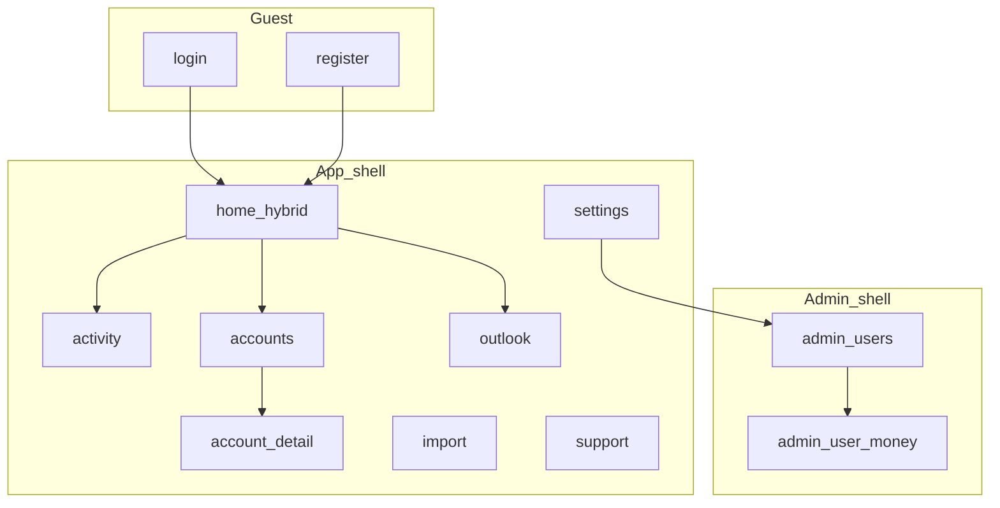

# UI / UX plan

Product UI information architecture and interaction patterns for the Angular PWA. Stack and client rules live in [design.md](../design.md). Scope and acceptance for the first release live in [mvp.md](mvp.md). Expensive IA choices: [DEC-011](../decisions/DEC-011-ui-ia.md).

**Status:** accepted as the source of truth for app structure. Implement shell and screens against this plan; do not invent parallel navigation or always-on CRUD stacks.

## Goals

1. Feel like a **personal finance app**, not a broken admin console of stacked forms.
2. Give every MVP workflow a **dedicated place** in the sitemap (home, activity, accounts, import, outlook, settings, admin).
3. Make the daily landing a **hybrid home**: balance boxes, recent movements with an Add dialog, and a short next-month outlook.
4. Keep **actuals distinct from projections** in layout and labeling.
5. Keep **instance admin** visually and structurally separate from personal money workflows.

## Non-goals

- Marketing / promotional landing page
- Full design-system component library beyond shared app patterns on PrimeNG
- Recipe / costing UI, settlement / IOU UX, rich household invite (see MVP out of scope and backlog)
- Rebrand beyond documented light/dark tokens; keep the current visual direction
- (calendars: see [DEC-013](../decisions/DEC-013-calendar-preference.md); Settings + shared date field/pipe)
- (theme: see [DEC-015](../decisions/DEC-015-theme-preference.md); Settings icon control + CSS tokens)

## Principles

1. **IA before chrome polish** — routes, shells, and “where does this live?” come first; visual polish follows.
2. **Lists first** — list/detail pages show data and a clear primary action; create/edit open in a dialog, drawer, or dedicated route — never always-visible form stacks under every list.
3. **Money is transparent** — balances and costs must show how they are derived (opening + movements when available); never silent rial/toman inference ([DEC-006](../decisions/DEC-006-money-multi-currency.md)).
4. **Actuals ≠ forecast** — Activity and account ledgers are historical; Outlook (and the home strip) are labeled projections ([mvp.md](mvp.md)).
5. **No cross-currency net worth** — group and total only within a currency ([DEC-006](../decisions/DEC-006-money-multi-currency.md)).
6. **One primary job per screen** — home composes three tight sections; other routes stay focused.
7. **RTL and i18n are first-class** — `fa` / `en`, logical CSS, PrimeNG locale tied to language ([DEC-009](../decisions/DEC-009-i18n.md)).

## Shells

Two shells ([DEC-011](../decisions/DEC-011-ui-ia.md)):

| Shell | Who | Chrome |
| --- | --- | --- |
| **App** | Authenticated user | Brand + primary nav + **user menu** in chrome (no separate top bar). User menu shows signed-in display name; Settings, Support, Admin if role, Sign out. No language control in App chrome — change language in Settings. |
| **Admin** | Instance `ADMIN` | Distinct admin header/context; back to app; same user menu; not the personal Accounts mental model |
| **Guest** | Unauthenticated | Minimal chrome (brand + **language** switcher); centered auth forms; no primary money nav |

**Status / API health** is not a primary-nav peer. Expose under Settings (or a hidden/dev route) only.

**Post-login / post-register** navigates to **`/`** (hybrid home), not profile.

## Sitemap (MVP)

### Guest

| Route | Purpose |
| --- | --- |
| `/login` | Sign in; optional TOTP second step |
| `/register` | Register when open / bootstrap; gated by registration status |

### App

| Route | Purpose |
| --- | --- |
| `/` | Hybrid home (balance boxes + recent log / Add + outlook strip) |
| `/activity` | Ledger list + time-range filters; full add/edit entry |
| `/accounts` | Wallets → accounts hierarchy and balances |
| `/accounts/:accountId` | Account detail, movements, shared members |
| `/import` | Statement upload, adapter choice, dedup feedback |
| `/outlook` | Next-month forecast detail (home shows summary only) |
| `/settings` | Settings shell; redirects to `/settings/profile` |
| `/settings/profile` | Display name, locale/timezone/calendar, theme, money display, Status link; sign-out on shell |
| `/settings/categories` | Income/expense category lists (add / rename / delete non-system) |
| `/settings/security` | TOTP enroll/disable |
| `/support` | Lightweight help / contact stub (user-menu entry only; not primary nav) |

Legacy `/wallets` and `/profile` should redirect into Accounts and Settings when the shell lands.

### Admin

| Route | Purpose |
| --- | --- |
| `/admin` | Registration toggle; user list (role, disable, delete) |
| `/admin/users/:userId` | Context banner “Acting as …”; that user’s wallets/accounts |

### Primary navigation (App)

**Home · Activity · Accounts · Import · Outlook**

Settings, Support, Sign out, and **Admin** (when `ADMIN`) live in the **user menu** — not as equal top-level primary destinations beside Status. Language switching for authenticated users is only on Settings; the Guest shell keeps the language control for login/register.

**Chrome layout (responsive):**

| Viewport | Layout |
| --- | --- |
| Wide (desktop) | Vertical rail at the **inline-start** (LTR: left; RTL: right): brand at top, primary links (icon + label), **user menu pinned at the rail foot**. No App top bar. |
| Narrow (mobile) | Fixed **bottom bar**: the five primary destinations (icon + short label) plus a compact **user menu** control at the trailing end. No App top bar. |

Primary labels and order stay the same across breakpoints. Do not invent extra primary destinations without updating this plan.

## Hybrid home (`/`)

One composition with three sections as a **dashboard surface**. No page title/lede — content starts with the panels. Sections use **surface panels** (padding, radius, soft background) separated by gap — not leading hairline rules. On wide viewports, Balances spans full width and **Recent** | **Outlook** sit side-by-side; on narrow viewports they stack. Missing data uses empty states, not blank panels. Loading uses skeletons for balance boxes and recent rows.

1. **Balances** — wrapping **row of account boxes** (name, wallet, currency, balance). Each box links to account detail. **No** single cross-currency total and no per-currency subtotal headers on home (currency is shown on each box). IRR toman presentation uses the shared money display and the Settings preference ([DEC-006](../decisions/DEC-006-money-multi-currency.md)). No local IRR/toman control on home. CTA: open Accounts or an account detail.
2. **Recent + Add** — short recent **income/expense** list (actuals only; exclude transfers; no forecast). Panel header includes an **Add** button that opens the shared Add dialog (PrimeNG SelectButton for Income / Expense / Transfer, each with icon + label; required category on income/expense; shared-cost mark on personal-account expense; amount, date/time, optional description). Transfers created here appear on Activity (not in the home recent list). Empty state offers Add when accounts exist. Link to `/activity` for the full ledger.
3. **Outlook strip** — short next-month summary **per currency** (expected income, expected expenses, and surplus/shortfall), clearly labeled as projections; link to `/outlook`. Until rules exist, show an empty projection state without inventing numbers ([recurrings-forecast.md](recurrings-forecast.md)).

When the user has no accounts: balances empty state with primary CTA “Create account”; Add and outlook disabled or explanatory.

## Screen inventory

### Login / Register

- Purpose: authenticate; respect registration open/bootstrap ([DEC-007](../decisions/DEC-007-auth.md), [DEC-010](../decisions/DEC-010-instance-admin.md)).
- Primary actions: submit; link between login and register; language switcher.
- Errors: inline message; no stack of unrelated panels.

### Home

- See [Hybrid home](#hybrid-home-).
- Loading: skeletons for balance boxes / recent rows; do not flash raw empty forms.

### Activity (`/activity`)

- Purpose: chronological ledger of actual movements; filter by useful time range.
- Primary actions: single **Add** opens the shared Add dialog (SelectButton: Income / Expense / Transfer); open row to edit (amount + metadata) or delete (ConfirmDialog). Account and type are not editable — delete + re-add. Edit uses type-specific dialogs (no type switcher).
- Empty: “No movements yet” + CTA to add or import.
- Must not mix unlabeled forecast rows into this list.

### Accounts (`/accounts`)

- Purpose: structure — wallets and accounts with balances.
- Primary actions: create wallet / create account via dialog or dedicated sub-route; navigate to account detail.
- Empty: CTA to create first wallet/account.
- **Not** a page of always-visible create forms under the list.

### Account detail (`/accounts/:accountId`)

- Purpose: one account’s balance story, movements, shared badge, member management (email add/remove per [wallets-accounts.md](wallets-accounts.md)).
- Primary actions: single **Add** opens the shared Add dialog (preselects this account for income/expense and transfer-from); edit/delete movements; manage members if shared; edit name when API allows. Edit stays type-specific.

### Import (`/import`)

- Purpose: upload statement; choose adapter (generic/synthetic first); confirm units when ambiguous (never silent rial/toman).
- After upload: show created count and skipped-duplicate count ([mvp.md](mvp.md) acceptance).
- Empty / first visit: short explanation + file picker.

### Outlook (`/outlook`)

- Purpose: next-month expected income, recurrings, surplus/shortfall **per currency**, labeled projections.
- Recurring rules are **managed on this page** (list + create/edit dialog) — not Settings ([recurrings-forecast.md](recurrings-forecast.md)).
- Empty until recurrings exist: explain and prompt to add a rule here.

### Settings (`/settings`)

- Shell at `/settings` with header (title, email, sign-out) and horizontal section nav (`routerLink` + active state). Bare `/settings` redirects to `/settings/profile`. Legacy `/profile` redirects to `/settings`.
- **Profile** (`/settings/profile`): display name, locale, timezone, **calendar** (Gregorian / Jalali) ([DEC-009](../decisions/DEC-009-i18n.md), [DEC-013](../decisions/DEC-013-calendar-preference.md)); **theme** (Light / Dark / System, default System) via icon segmented control ([DEC-015](../decisions/DEC-015-theme-preference.md)); **IRR presentation** (rials vs labeled toman, `÷ 10`); optional Status/health link.
- **Categories** (`/settings/categories`): income/expense lists (add / rename / delete non-system; system Uncategorized locked) — not a primary-nav peer ([transactions.md](transactions.md)).
- **Security** (`/settings/security`): TOTP enroll/disable.
- Authenticated language changes happen on Profile (not in App/Admin toolbar). Admin entry remains in the user menu for admins.

### Support (`/support`)

- Purpose: short help / how to get support stub; reachable from the user menu only.
- Keep empty-state honest until a real support channel is specified.

### Admin (`/admin`, `/admin/users/:userId`)

- Purpose: instance control ([DEC-010](../decisions/DEC-010-instance-admin.md)) — registration, users, then “acting as” money management.
- **Acting-as banner** required on user money views so they are never confused with the admin’s own Accounts.
- Destructive actions: ConfirmDialog (not `window.confirm`); last-admin safeguards surfaced in UI copy.
- Money presentation matches App (shared money component), including IRR toman labeling.

## Shared patterns

### Money display

- Input/storage: integer minor units as digit strings on the wire.
- Display: shared formatter; currency code visible; IRR may present as **labeled** toman (`÷ 10`) when the user opts in.
- **Preference control lives only in Settings** (not on home or other money lists). Preference is local (`localStorage`) for MVP; applies app-wide including admin-as-user views.
- Same formatter on home, accounts, activity amounts, admin-as-user views.
- Never show a merged multi-currency “net worth”.

### Dates

- Profile **calendar** preference (`GREGORIAN` | `JALALI`, default Jalali) is independent of UI language ([DEC-013](../decisions/DEC-013-calendar-preference.md)). Storage and API remain ISO instants.
- Shared datetime pipe and field drive list formatting, form pickers, and Activity “this month” bounds (user calendar + timezone; unset TZ → UTC). Outlook “next month” labels follow the forecast payload’s calendar year/month.
- Preference control lives in Settings (profile + localStorage cache), same dual-write pattern as UI language.
- **Jalali form field** (`app-date-time-field`): typeable wall-clock input (`yyyy/MM/dd HH:mm`, Persian digits accepted); calendar toggle opens a **body overlay** (not inline under the field) so dialogs do not clip it; year jump in the panel; typeable `HH:mm` time; dismiss via outside click, Escape, or Done. Invalid typed values revert to the last good value (no silent wrong date). Gregorian continues to use PrimeNG DatePicker.

### Forms and chrome

- Prefer PrimeNG Select over native `<select>` for visual consistency.
- Create/edit: Dialog or Drawer; ConfirmDialog for delete/disable; Toast for success feedback.
- Loading: ProgressSpinner / skeleton — not bare “Loading…” as the only pattern.
- Empty states: one sentence + one primary CTA.
- Online-only ledger: if API unreachable, show a clear reconnect message ([DEC-003](../decisions/DEC-003-pwa-scope.md)).

### Visual tokens (keep current direction)

Document in implementation, do not rebrand:

- Fonts: IBM Plex Sans (body), Source Serif 4 (headings/brand), Vazirmatn when `lang=fa`
- Accent / links: blue around `#1d4ed8` (dark `#60a5fa`); page ground neutral gray `#eef0f2`; surfaces white / dark gray for navbars; text `#1c2a27` (light); dark counterparts under `html.app-dark`; PrimeNG Aura primary palette is blue
- Theme: PrimeNG Aura with class-based dark (`html.app-dark`); profile preference Light / Dark / System (default System) ([DEC-015](../decisions/DEC-015-theme-preference.md))
- Appearance control in Settings: icon segmented `SelectButton` (sun / moon / desktop)—not a dropdown
- Prefer CSS variables in `styles.scss` for shared shell/page surfaces so page SCSS stops forking hex values

### i18n

- All new chrome strings in `public/i18n/fa.json` and `en.json`.
- API error bodies may stay untranslated; client shows catalog fallbacks where useful.

## Mapping unbuilt MVP features into slots

| MVP capability | UI slot |
| --- | --- |
| Manual income/expense | Shared Add dialog (Home, Activity, Account detail) |
| Same-currency transfers | Shared Add dialog (Home, Activity, Account detail) |
| Shared mark on personal expense | Shared Add expense + edit forms |
| Categories (typed, required) | Add/edit fields on shared Add / Activity edit / account detail edit; manage lists in `/settings/categories` |
| CSV import + dedup | `/import` |
| Recurring rules | Managed on `/outlook` (list + dialog) |
| Next-month forecast | Home strip + `/outlook` |
| Wallets/accounts (done API) | `/accounts`, `/accounts/:accountId` |
| Auth / profile / TOTP (done) | Guest routes + `/settings/profile` + `/settings/security` |
| Instance admin (done API) | Admin shell |

Later feature slices must **fill these routes**, not invent new top-level nav items without updating this plan.

## Acceptance criteria (“feels like an app”)

- Authenticated users see App primary nav (Home, Activity, Accounts, Import, Outlook) as a start-side vertical rail on wide viewports and as an icon+label bottom bar on narrow viewports, with the user menu in the rail foot / bottom-bar trailing end (no App top bar), and land on `/` after login. Language switcher appears on Guest shell only; Settings holds language for signed-in users.
- Hybrid home shows surface-panel balance boxes (from available APIs), a recent income/expense log with a shared Add dialog (SelectButton for income/expense/transfer; not an inline form), and an outlook strip with per-currency income/expense/surplus; wide layout places Recent and Outlook side-by-side; loading uses skeletons.
- List pages (Accounts, Activity, Admin users) do **not** permanently show create forms inline under the list; create uses dialog/drawer/route.
- Status is not in primary nav.
- Admin user-money views show an acting-as context banner and use the same money presentation rules as App.
- No cross-currency net-worth total anywhere in UI.
- Forecast copy is labeled as projection wherever shown.
- `fa` / `en` and RTL continue to work for new chrome ([DEC-009](../decisions/DEC-009-i18n.md)).
- Theme preference Light / Dark / System (default System) applies via Settings icon control and persists on the profile ([DEC-015](../decisions/DEC-015-theme-preference.md)).

## Out of scope for this plan’s UI work

- Implementing transaction/import/forecast APIs (separate slices; UI slots reserved above)
- Full PrimeNG theme customization beyond Aura + light/dark tokens
- Recipe costing, loan advice, settlement ledger, public multi-tenant polish

## Related docs

| Doc | Role |
| --- | --- |
| [mvp.md](mvp.md) | Release goals and acceptance |
| [design.md](../design.md) | Architecture and frontend stack rules |
| [DEC-011](../decisions/DEC-011-ui-ia.md) | Hybrid home + dual shells decision |
| [DEC-003](../decisions/DEC-003-pwa-scope.md) | Online-only money |
| [DEC-005](../decisions/DEC-005-wallets-and-accounts.md) | Wallets / shared accounts |
| [DEC-006](../decisions/DEC-006-money-multi-currency.md) | Money presentation |
| [DEC-009](../decisions/DEC-009-i18n.md) | UI language / RTL |
| [DEC-010](../decisions/DEC-010-instance-admin.md) | Admin capabilities |
