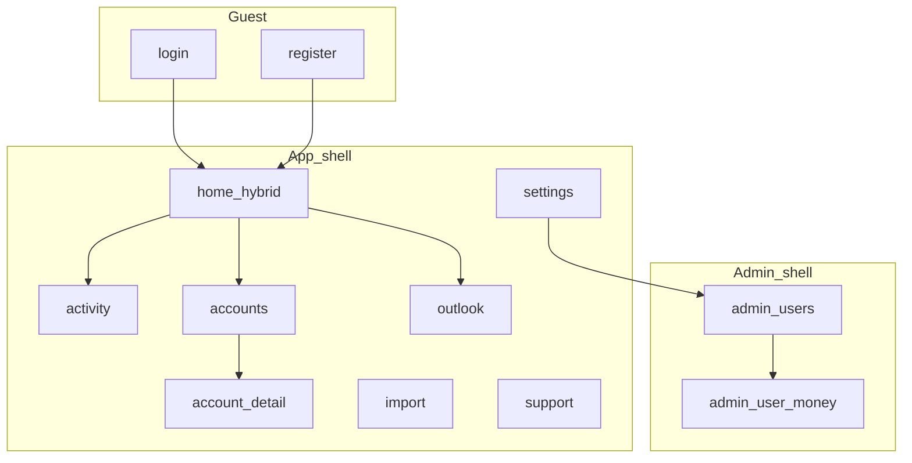

# UI / UX plan

Product UI information architecture and interaction patterns for the Angular PWA. Stack and client rules live in [design.md](../design.md). Scope and acceptance for the first release live in [mvp.md](mvp.md). Expensive IA choices: [DEC-011](../decisions/DEC-011-ui-ia.md).

**Status:** accepted as the source of truth for app structure. Implement shell and screens against this plan; do not invent parallel navigation or always-on CRUD stacks.

## Goals

1. Feel like a **personal finance app**, not a broken admin console of stacked forms.
2. Give every MVP workflow a **dedicated place** in the sitemap (home, activity, accounts, import, outlook, settings, admin).
3. Make the daily landing a **hybrid home**: balance boxes, recent movements with an Add dialog, and a short next-month outlook.
4. Keep **actuals distinct from projections** in layout and labeling.
5. Keep **instance admin** visually and structurally separate from personal money workflows.

## Non-goals

- Marketing / promotional landing page
- Full design-system component library beyond shared app patterns on PrimeNG
- Recipe / costing UI, settlement / IOU UX, rich household invite (see MVP out of scope and backlog)
- Rebrand beyond documented light/dark tokens; keep the current visual direction
- (calendars: see [DEC-013](../decisions/DEC-013-calendar-preference.md); Settings + shared date field/pipe)
- (theme: see [DEC-015](../decisions/DEC-015-theme-preference.md); Settings icon control + CSS tokens)

## Principles

1. **IA before chrome polish** — routes, shells, and “where does this live?” come first; visual polish follows.
2. **Lists first** — list/detail pages show data and a clear primary action; create/edit open in a dialog, drawer, or dedicated route — never always-visible form stacks under every list.
3. **Money is transparent** — balances and costs must show how they are derived (opening + movements when available); never silent rial/toman inference ([DEC-006](../decisions/DEC-006-money-multi-currency.md)).
4. **Actuals ≠ forecast** — Activity and account ledgers are historical; Outlook (and the home strip) are labeled projections ([mvp.md](mvp.md)).
5. **No cross-currency net worth** — group and total only within a currency ([DEC-006](../decisions/DEC-006-money-multi-currency.md)).
6. **One primary job per screen** — home composes three tight sections; other routes stay focused.
7. **RTL and i18n are first-class** — `fa` / `en`, logical CSS, PrimeNG locale tied to language ([DEC-009](../decisions/DEC-009-i18n.md)).

## Shells

Two shells ([DEC-011](../decisions/DEC-011-ui-ia.md)):

| Shell | Who | Chrome |
| --- | --- | --- |
| **App** | Authenticated user | Brand + primary nav + **user menu** in chrome (no separate top bar). User menu shows signed-in display name; Settings, Support, Admin if role, Sign out. No language control in App chrome — change language in Settings. |
| **Admin** | Instance `ADMIN` | Distinct admin header/context; back to app; same user menu; not the personal Accounts mental model |
| **Guest** | Unauthenticated | Minimal chrome (brand + **language** switcher); centered auth forms; no primary money nav |

**Status / API health** is not a primary-nav peer. Expose under Support (or a hidden/dev route) only.

**Post-login / post-register** navigates to **`/`** (hybrid home), not profile.

## Sitemap (MVP)

### Guest

| Route | Purpose |
| --- | --- |
| `/login` | Sign in; optional TOTP second step |
| `/register` | Register when open / bootstrap; gated by registration status |

### App

| Route | Purpose |
| --- | --- |
| `/` | Hybrid home (balance boxes + recent log / Add + outlook strip) |
| `/activity` | Ledger list + time-range filters; full add/edit entry |
| `/accounts` | Wallets → accounts hierarchy and balances |
| `/accounts/:accountId` | Account detail, movements, shared members |
| `/import` | Statement upload, adapter choice, dedup feedback |
| `/outlook` | Next-month forecast detail (home shows summary only) |
| `/settings` | Settings shell; redirects to `/settings/profile` |
| `/settings/profile` | Display name, locale/timezone/calendar, theme, money display; sign-out on shell |
| `/settings/categories` | Income/expense/transfer category lists (system catalog read-only; user add/edit/delete with icon + color) |
| `/settings/security` | TOTP enroll/disable |
| `/support` | Lightweight help / contact stub; API status link (user-menu entry only; not primary nav) |

Legacy `/wallets` and `/profile` should redirect into Accounts and Settings when the shell lands.

### Admin

| Route | Purpose |
| --- | --- |
| `/admin` | Registration toggle; user list (role, disable, delete) |
| `/admin/users/:userId` | Context banner “Acting as …”; that user’s wallets/accounts |

### Primary navigation (App)

**Home · Activity · Accounts · Import · Outlook**

Settings, Support, Sign out, and **Admin** (when `ADMIN`) live in the **user menu** — not as equal top-level primary destinations beside Status. Language switching for authenticated users is only on Settings; the Guest shell keeps the language control for login/register.

**Chrome layout (responsive):**

| Viewport | Layout |
| --- | --- |
| Wide (desktop) | Vertical rail at the **inline-start** (LTR: left; RTL: right): brand at top, primary links (icon + label), **user menu pinned at the rail foot**. No App top bar. |
| Narrow (mobile) | Fixed **bottom bar**: the five primary destinations (icon + short label) plus a compact **user menu** control at the trailing end. No App top bar. |

Primary labels and order stay the same across breakpoints. Do not invent extra primary destinations without updating this plan.

## Hybrid home (`/`)

One composition with three sections as a **dashboard surface**. No page title/lede — content starts with the panels. Sections use **surface panels** (padding, radius, soft background) separated by gap — not leading hairline rules. On wide viewports, Balances spans full width and **Recent** | **Outlook** sit side-by-side; on narrow viewports they stack. Missing data uses empty states, not blank panels. Loading uses skeletons for balance boxes and recent rows.

1. **Balances** — wrapping **row of account boxes** (name, wallet, currency, balance). Each box links to account detail. **No** single cross-currency total and no per-currency subtotal headers on home (currency is shown on each box). IRR toman presentation uses the shared money display and the Settings preference ([DEC-006](../decisions/DEC-006-money-multi-currency.md)). No local IRR/toman control on home. CTA: open Accounts or an account detail.
2. **Recent + Add** — short recent **income/expense** list (actuals only; exclude transfers; no forecast). Panel header includes an **Add** button that opens the shared Add dialog (PrimeNG SelectButton for Income / Expense / Transfer, each with icon + label; required category on all types with icon + color + localized label; shared-cost mark on personal-account expense; amount, date/time, optional description). Transfers created here appear on Activity (not in the home recent list). Empty state offers Add when accounts exist. Link to `/activity` for the full ledger.
3. **Outlook strip** — short next-month summary **per currency** (expected income, expected expenses, and surplus/shortfall), clearly labeled as projections; link to `/outlook`. Until rules exist, show an empty projection state without inventing numbers ([recurrings-forecast.md](recurrings-forecast.md)).

When the user has no accounts: balances empty state with primary CTA “Create account”; Add and outlook disabled or explanatory.

## Screen inventory

### Login / Register

- Purpose: authenticate; respect registration open/bootstrap ([DEC-007](../decisions/DEC-007-auth.md), [DEC-010](../decisions/DEC-010-instance-admin.md)).
- Primary actions: submit; link between login and register; language switcher.
- Errors: inline message; no stack of unrelated panels.

### Home

- See [Hybrid home](#hybrid-home-).
- Loading: skeletons for balance boxes / recent rows; do not flash raw empty forms.

### Activity (`/activity`)

- Purpose: chronological ledger of actual movements; one focused list page.
- Visual language matches home/settings: **surface panels** (padding, radius, soft background) for filters, period summary, and the day-grouped list — not leading hairline rules. Loading uses skeletons.
- Filters (live — no Apply): time range, account, type (All / Income / Expense / Transfer). Client-side **search** filters the loaded result by description, category label, and account names.
- **Period summary** panel (per currency, from the visible filtered set): Income, Expense, Net (income−expense). Transfers never enter net; show a separate Transfers total when type is All or Transfer. No cross-currency totals.
- List: day-grouped by user calendar + timezone ([DEC-013](../decisions/DEC-013-calendar-preference.md)); newest day first. Rows show type (income/expense color cues), amount, account (→ counter for transfers), time, category chip, shared mark, description.
- Primary actions: single **Add** opens the shared Add dialog (SelectButton: Income / Expense / Transfer); **click/tap row** opens type-specific edit (amount + metadata). Delete lives in the edit dialog (ConfirmDialog). Account and type are not editable — delete + re-add.
- Empty: “No movements yet” + CTA to add and/or import. Distinct copy when filters/search yield no rows.
- Must not mix unlabeled forecast rows into this list.

### Accounts (`/accounts`)

- Purpose: structure — wallets and accounts with balances; one focused list page.
- Visual language matches home/activity/settings: **surface panels** (padding, radius, soft background) for wallet blocks and “Shared with you” — not leading hairline rules. Loading uses skeletons. Layout width/rhythm aligns with Home/Activity (`~58rem`, panel gap).
- Hierarchy: owned wallets with nested accounts; optional **Shared with you** section for accounts whose wallet the user does not own. **No** cross-currency total.
- Account rows: link to detail; name, Shared badge when applicable, balance (`Name (CODE)` currency chrome + opening in meta), member names when more than one.
- Primary actions: create wallet / create account via **dialog** (searchable currency allowlist, `app-amount-input` opening, shared checkbox); navigate to account detail. Prefer opening Create account from an empty wallet’s CTA as well as the header.
- Empty: one sentence + primary CTA to create first wallet. Per-wallet empty accounts: sentence + Create account CTA.
- **Not** a page of always-visible create forms under the list.
- Admin-as-user money list (`/admin/users/:userId`) uses the same surface-panel / skeleton / money chrome; acting-as banner stays ([instance-admin.md](instance-admin.md)).

### Account detail (`/accounts/:accountId`)

- Purpose: one account’s balance story, movements, shared badge, member management (email add/remove per [wallets-accounts.md](wallets-accounts.md)).
- Visual language: **surface panels** for Balance, Movements, and Members (when shared); skeletons while loading; same max-width rhythm as Accounts/Activity.
- **Balance** panel: large current balance + opening amount + copy that balance is opening plus recorded movements. Currency chrome as `Name (CODE)`; Shared badge in the header lede.
- **Movements** panel: day-grouped by user calendar + timezone (same helper as Activity); newest day first. Rows show type (income/expense color cues), amount, transfer counter direction relative to this account, time, category chip, shared mark, description. **Click/tap row** opens type-specific edit; Delete lives in the edit dialog (ConfirmDialog). Account and type are not editable — delete + re-add.
- Empty movements: one sentence + primary **Add** (+ optional link to `/activity`).
- Primary actions: single **Add** opens the shared Add dialog (preselects this account for income/expense and transfer-from); **Rename** opens a dialog that PATCHes name only (currency and opening balance immutable); when shared, **Add member** by email and **remove member** with ConfirmDialog (API rejects removing the last owner — surface the error).

### Import (`/import`)

- Purpose: upload statement; choose adapter (generic/synthetic first); confirm units when ambiguous (never silent rial/toman).
- After upload: show created count and skipped-duplicate count ([mvp.md](mvp.md) acceptance).
- Empty / first visit: short explanation + file picker.

### Outlook (`/outlook`)

- Purpose: next-month expected income, recurrings, surplus/shortfall **per currency**, labeled projections.
- Recurring rules are **managed on this page** (list + create/edit dialog) — not Settings ([recurrings-forecast.md](recurrings-forecast.md)).
- Empty until recurrings exist: explain and prompt to add a rule here.

### Settings (`/settings`)

- Shell at `/settings` with header (title, email, sign-out) and horizontal section nav (`routerLink` + active state). Bare `/settings` redirects to `/settings/profile`. Legacy `/profile` redirects to `/settings`.
- Visual language matches home: **surface panels** (padding, radius, soft background, subtle border) separated by gap — not leading hairline rules. Section content lives in panels; shell chrome (title + nav) sits above without a bottom rule.
- Prefer PrimeNG Select / SelectButton over native controls for locale, timezone, calendar, and theme.
- **Profile** (`/settings/profile`): display name, locale, timezone, **calendar** (Gregorian / Jalali) ([DEC-009](../decisions/DEC-009-i18n.md), [DEC-013](../decisions/DEC-013-calendar-preference.md)); **theme** (Light / Dark / System, default System) via icon segmented control ([DEC-015](../decisions/DEC-015-theme-preference.md)); **IRR presentation** (rials vs labeled toman, `÷ 10`) as its own panel.
- **Categories** (`/settings/categories`): income, expense, and transfer as separate surface panels (system catalog read-only with icon + color; user add/edit/delete with icon + color pickers); loading uses skeletons — not a primary-nav peer ([transactions.md](transactions.md), [DEC-016](../decisions/DEC-016-category-catalog.md)).
- **Security** (`/settings/security`): TOTP enroll/disable in a surface panel.
- Authenticated language changes happen on Profile (not in App/Admin toolbar). Admin entry remains in the user menu for admins.

### Support (`/support`)

- Purpose: short help / how to get support stub; reachable from the user menu only.
- Keep empty-state honest until a real support channel is specified.
- Expose **API status / health** link here (route `/status` remains; not primary nav).

### Admin (`/admin`, `/admin/users/:userId`)

- Purpose: instance control ([DEC-010](../decisions/DEC-010-instance-admin.md)) — registration, users, then “acting as” money management.
- **Acting-as banner** required on user money views so they are never confused with the admin’s own Accounts.
- Destructive actions: ConfirmDialog (not `window.confirm`); last-admin safeguards surfaced in UI copy.
- Money presentation matches App (shared money component), including IRR toman labeling.

## Shared patterns

### Money display

- Input/storage: integer minor units as digit strings on the wire.
- Display: shared formatter with locale thousand separators (`en`: `,`; `fa`: `٬`); currency/unit label visible; IRR may present as **labeled** toman (`÷ 10`) when the user opts in. Money amounts (lists, balances, opening, inputs) use **LTR isolate** so the minus sign stays before the digits in RTL layouts.
- **Currency in chrome** (account boxes, account detail lede, accounts list meta, outlook per-currency headers/rules, create-account/recurring selects, admin-as-user account meta): show **`Name (CODE)`** via `Intl.DisplayNames` for the active UI locale (e.g. `Euro (EUR)` / `یورو (EUR)`). Transloco is not used for ISO currency names. Unknown codes fall back to the bare code.
- **Currency pickers** (create account, outlook recurrings, admin-as-user): searchable PrimeNG Select over a fixed Iranian-first **UI allowlist** — `IRR, USD, EUR, GBP, AED, TRY, CAD, AUD, CHF, JPY` — defined in one shared web constant so expansion is configuration-only. API/DB remain any valid ISO 4217 code ([DEC-006](../decisions/DEC-006-money-multi-currency.md)); the allowlist is UI-only.
- **Amount inputs:** shared `app-amount-input` — typeable digit field with the same locale separators while editing; Persian (`۰-۹`) and Arabic-Indic (`٠-٩`) digits are accepted on type/paste, counted for caret placement, and normalized to Latin digits in the field and model; model value stays an ungrouped digit string (optional leading `-` only where opening balance allows negatives). Never use binary floating-point inputs for money.
- **Preference control lives only in Settings** (not on home or other money lists). Preference is local (`localStorage`) for MVP; applies app-wide including admin-as-user views.
- Same formatter on home, accounts, activity amounts, admin-as-user views.
- Never show a merged multi-currency “net worth”.

### Dates

- Profile **calendar** preference (`GREGORIAN` | `JALALI`, default Jalali) is independent of UI language ([DEC-013](../decisions/DEC-013-calendar-preference.md)). Storage and API remain ISO instants.
- Shared datetime pipe and field drive list formatting, form pickers, and Activity “this month” bounds (user calendar + timezone; unset TZ → UTC). Outlook “next month” labels follow the forecast payload’s calendar year/month.
- Preference control lives in Settings (profile + localStorage cache), same dual-write pattern as UI language.
- **Unified form field** (`app-date-time-field`) for both Gregorian and Jalali (no PrimeNG DatePicker): compact **±1 day** strip with relative labels within ±7 days including wall-clock time (e.g. `(yesterday, 1404/08/08 14:30)`, `(3 days ago, …)`); center is typeable wall-clock (`yyyy/MM/dd HH:mm`, Persian digits accepted); calendar toggle opens a **body overlay** (dialog-safe) with weekday headers (**Sat→Fri** Jalali, **Sun→Sat** Gregorian), offset-aligned month grid, **day-off coloring** (Jalali: Fridays + Iran official holidays for 1403–1406; Gregorian: Sat/Sun + same Iran holidays via Jalali conversion), year jump, typeable `HH:mm`, **Now** (shown only when current instant is within min/max) jumps to current date-time and today’s cell is outlined; dismiss via outside click, Escape, or Done. Invalid typed values revert to the last good value (no silent wrong date). Optional `minUnix` / `maxUnix` (epoch ms) disable out-of-range steps/days and reject commits outside bounds — call sites opt in when needed.

### Forms and chrome

- Prefer PrimeNG Select over native `<select>` for visual consistency.
- PrimeNG overlays (Select, etc.) append to `body` (`overlayAppendTo`) so panels are not clipped by Dialog/Drawer overflow and do not force modal scroll — same dialog-safe idea as the date field’s body overlay.
- Create/edit: Dialog or Drawer; ConfirmDialog for delete/disable; Toast for success feedback.
- Loading: ProgressSpinner / skeleton — not bare “Loading…” as the only pattern.
- Empty states: one sentence + one primary CTA.
- Online-only ledger: if API unreachable, show a clear reconnect message ([DEC-003](../decisions/DEC-003-pwa-scope.md)).

### Visual tokens (keep current direction)

Document in implementation, do not rebrand:

- Fonts: IBM Plex Sans (body), Source Serif 4 (headings/brand), Vazirmatn when `lang=fa`
- Accent / links: blue around `#1d4ed8` (dark `#60a5fa`); page ground neutral gray `#eef0f2`; surfaces white / dark gray for navbars; text `#1c2a27` (light); dark counterparts under `html.app-dark`; PrimeNG Aura primary palette is blue
- Theme: PrimeNG Aura with class-based dark (`html.app-dark`); profile preference Light / Dark / System (default System) ([DEC-015](../decisions/DEC-015-theme-preference.md))
- Appearance control in Settings: icon segmented `SelectButton` (sun / moon / desktop)—not a dropdown
- Prefer CSS variables in `styles.scss` for shared shell/page surfaces (including panel background/border/radius/shadow) so page SCSS stops forking hex values
- Surface-panel pages (home, settings, and later peers): gap between panels, no leading separators

### i18n

- All new chrome strings in `public/i18n/fa.json` and `en.json`.
- API error bodies may stay untranslated; client shows catalog fallbacks where useful.

## Mapping unbuilt MVP features into slots

| MVP capability | UI slot |
| --- | --- |
| Manual income/expense | Shared Add dialog (Home, Activity, Account detail) |
| Same-currency transfers | Shared Add dialog (Home, Activity, Account detail) |
| Shared mark on personal expense | Shared Add expense + edit forms |
| Categories (typed, required; icons + colors) | Add/edit fields on shared Add / Activity edit / account detail edit (all movement types); manage lists in `/settings/categories` |
| CSV import + dedup | `/import` |
| Recurring rules | Managed on `/outlook` (list + dialog) |
| Next-month forecast | Home strip + `/outlook` |
| Wallets/accounts (done API) | `/accounts`, `/accounts/:accountId` |
| Auth / profile / TOTP (done) | Guest routes + `/settings/profile` + `/settings/security` |
| Instance admin (done API) | Admin shell |

Later feature slices must **fill these routes**, not invent new top-level nav items without updating this plan.

## Acceptance criteria (“feels like an app”)

- Authenticated users see App primary nav (Home, Activity, Accounts, Import, Outlook) as a start-side vertical rail on wide viewports and as an icon+label bottom bar on narrow viewports, with the user menu in the rail foot / bottom-bar trailing end (no App top bar), and land on `/` after login. Language switcher appears on Guest shell only; Settings holds language for signed-in users.
- Hybrid home shows surface-panel balance boxes (from available APIs), a recent income/expense log with a shared Add dialog (SelectButton for income/expense/transfer; not an inline form), and an outlook strip with per-currency income/expense/surplus; wide layout places Recent and Outlook side-by-side; loading uses skeletons.
- List pages (Accounts, Activity, Admin users) do **not** permanently show create forms inline under the list; create uses dialog/drawer/route.
- Status is not in primary nav.
- Admin user-money views show an acting-as context banner and use the same money presentation rules as App.
- No cross-currency net-worth total anywhere in UI.
- Forecast copy is labeled as projection wherever shown.
- `fa` / `en` and RTL continue to work for new chrome ([DEC-009](../decisions/DEC-009-i18n.md)).
- Account/outlook chrome shows `Name (CODE)` via `Intl.DisplayNames` when the UI language changes; currency pickers are searchable over the Iranian-first UI allowlist.
- Theme preference Light / Dark / System (default System) applies via Settings icon control and persists on the profile ([DEC-015](../decisions/DEC-015-theme-preference.md)).
- Settings uses the same surface-panel language as home (profile / categories / security sections).
- Accounts list and account detail use the same surface-panel language as home/activity (wallet panels, balance/movements/members); account detail movements are day-grouped with clickable rows and delete in the edit dialog.

## Out of scope for this plan’s UI work

- Implementing transaction/import/forecast APIs (separate slices; UI slots reserved above)
- Full PrimeNG theme customization beyond Aura + light/dark tokens
- Recipe costing, loan advice, settlement ledger, public multi-tenant polish

## Related docs

| Doc | Role |
| --- | --- |
| [mvp.md](mvp.md) | Release goals and acceptance |
| [design.md](../design.md) | Architecture and frontend stack rules |
| [DEC-011](../decisions/DEC-011-ui-ia.md) | Hybrid home + dual shells decision |
| [DEC-003](../decisions/DEC-003-pwa-scope.md) | Online-only money |
| [DEC-005](../decisions/DEC-005-wallets-and-accounts.md) | Wallets / shared accounts |
| [DEC-006](../decisions/DEC-006-money-multi-currency.md) | Money presentation |
| [DEC-009](../decisions/DEC-009-i18n.md) | UI language / RTL |
| [DEC-010](../decisions/DEC-010-instance-admin.md) | Admin capabilities |
